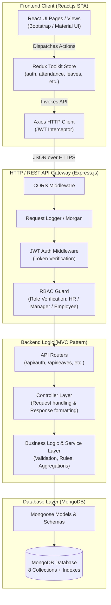
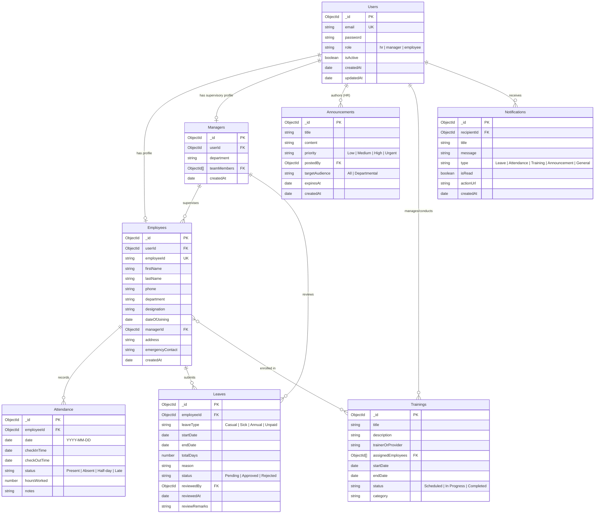
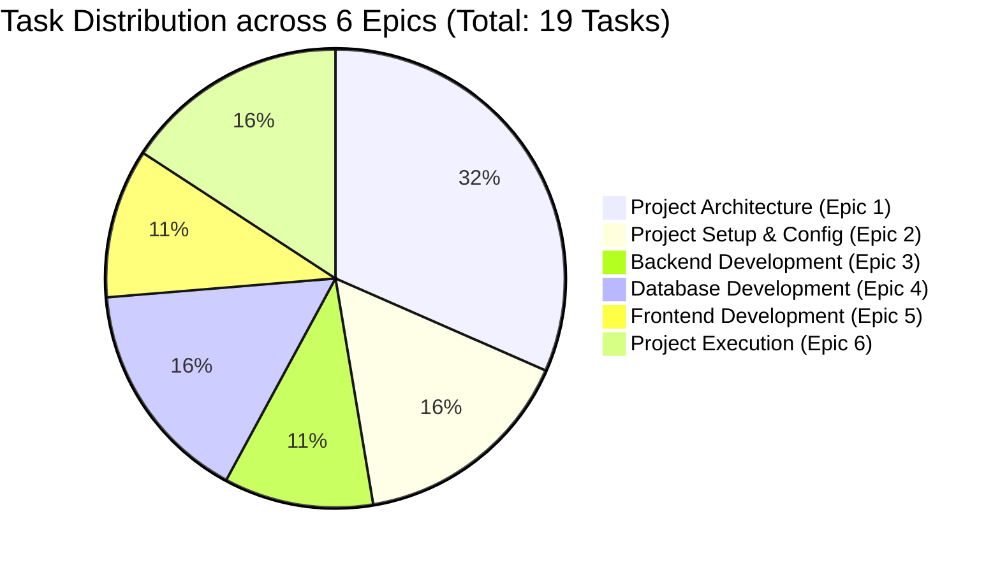
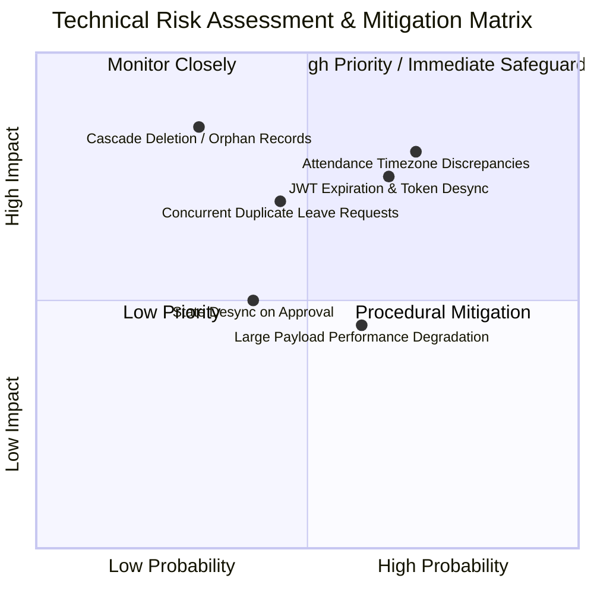

# StaffSync — Comprehensive Project Plan & Architectural Blueprint

## 1. Executive Summary
**StaffSync** is an enterprise-grade Human Resource Management System (HRMS) developed strictly on the **MERN Stack** (MongoDB, Express.js, React.js, Node.js). It centralizes and automates core workforce operations—including profile administration, biometric/digital attendance logging, tiered leave approval lifecycles, team supervision, company broadcasts, and professional training coordination—under a unified, role-governed web platform.

This project plan establishes the technical foundation, system architecture, database schema, risk mitigations, and epic breakdown derived directly from the project specification documents (`SkillWallet(1).pdf` through `SkillWallet(4).pdf`).

---

## 2. Project Scope & Boundaries

### 2.1 In-Scope Deliverables
- **Core Technology Stack:** 100% JavaScript/Node ecosystem using MongoDB, Express.js, React.js, and Node.js.
- **Roles & Permissions:** Role-Based Access Control (RBAC) across three primary actor tiers: **Employee**, **Manager**, and **HR Personnel**.
- **8 Core Database Collections:** `Users`, `Employees`, `Managers`, `Attendance`, `Leaves`, `Announcements`, `Trainings`, `Notifications`.
- **Core Functional Modules:**
  1. Authentication & Session Management (JWT, bcryptjs)
  2. Employee Self-Service & Directory Management
  3. Manager Supervision & Team Roster Control
  4. Attendance Recording & Automated Status Calculation
  5. Tiered Leave Application & Review Workflow
  6. Company Announcements & Broadcast Noticeboard
  7. Training Program Creation, Enrollment & Tracking
  8. Employee Performance Monitoring
  9. In-App Notification System
  10. Dedicated Role Dashboards (Employee, Manager, HR) & HR Analytics
- **Non-Functional Attributes:** Performance optimization (DB indexing, pagination, lazy loading), responsive design (Bootstrap/Material-UI), and automated/manual testing suites.

### 2.2 Out-of-Scope (Until Post-MVP)
- Replacement of MongoDB with alternative databases (e.g., Firebase, PostgreSQL).
- Third-party paid cloud services, real SMS gateways, or paid biometric hardware integrations.
- Multi-tenant enterprise billing or payroll processing (unless added in subsequent phases).

---

## 3. Technology Stack Specification

The technology stack is specified strictly according to the project specifications:

| Layer | Technology | Version Baseline | Role in Architecture |
| :--- | :--- | :--- | :--- |
| **Runtime Environment** | Node.js | v16.0.0+ (Tested on v24) | Server-side execution runtime powering API routing, business logic, and background processing. |
| **Package Management** | npm | v8.0.0+ | Dependency resolution and script automation. |
| **Backend Framework** | Express.js | v4.18+ / v5.x | RESTful API routing, middleware execution pipeline, and HTTP request handling. |
| **Database Engine** | MongoDB | v6.0+ | Document-oriented NoSQL database storing structured and semi-structured collections. |
| **Object Data Modeling** | Mongoose | v7.x / v8.x | Schema definition, data validation, relationship mapping, and indexing. |
| **Security & Auth** | JSON Web Tokens (`jsonwebtoken`) & `bcryptjs` | Latest stable | Stateless cryptographic token authentication, claims handling, and one-way password hashing. |
| **Cross-Origin & Config** | `cors`, `dotenv` | Latest stable | Cross-Origin Resource Sharing control and environment variable encapsulation. |
| **Frontend Library** | React.js | v18.x | Declarative, component-driven reactive user interface layer. |
| **Client Routing** | React Router (`react-router-dom`) | v6.x | Single Page Application (SPA) client routing and role-guarded route trees. |
| **State Management** | Redux Toolkit (`@reduxjs/toolkit`, `react-redux`) | Latest stable | Centralized immutable application state, async thunks, and slice management. |
| **HTTP Client** | Axios | Latest stable | Promise-based HTTP client with request/response interceptors for JWT token injection. |
| **UI Framework / Styling** | Bootstrap / Material UI | Latest stable | Mobile-responsive design, adaptive grid layouts, and standardized UI components. |
| **Tooling & IDE** | VS Code & Postman | Standard | Code authoring, terminal interaction, Git version control, and API testing. |

---

## 4. Application Architecture

StaffSync adopts a **Decoupled Client-Server Architecture** utilizing an **MVC (Model-View-Controller)** pattern on the Express.js backend, complemented by a **Unidirectional Data Flow (Redux Toolkit)** on the React.js client.

### 4.1 System Architecture Diagram



### 4.2 Backend MVC Architecture
1. **Model Layer (`/models`):** Strict Mongoose schemas with data types, validation hooks, virtual properties, pre-save encryption middleware (passwords), and indexing.
2. **Controller Layer (`/controllers`):** Receives validated requests, interfaces with the service/data layer, manages error boundaries, and produces standardized JSON responses:
   ```json
   {
     "success": true,
     "message": "Resource fetched successfully",
     "data": { ... }
   }
   ```
3. **Route / Middleware Layer (`/routes`, `/middleware`):** Decoupled route declarations bound to authentication (`verifyToken`) and authorization (`authorizeRoles('hr', 'manager', 'employee')`) middlewares.

### 4.3 Frontend Component & State Architecture
1. **Component Hierarchy:** Layout wrappers (`DashboardLayout`, `AuthLayout`), reusable atomic components (`StatusBadge`, `DataTable`, `AttendancePunchCard`, `StatsCard`, `ModalDialog`), and role-specific views.
2. **Redux Store Architecture:** Slices for `auth`, `employee`, `manager`, `attendance`, `leave`, `announcement`, `training`, and `notification`.
3. **Protected Route Strategy:** Higher-Order Components / `<Navigate />` guards checking token presence and role authorization before mounting private routes.

---

## 5. Proposed Database Schema (MongoDB & Mongoose)

The data model encompasses **8 collections** as mandated by the project requirements.

### 5.1 Entity Relationship Diagram



### 5.2 Schema Specifications & Indexing Strategy

#### 1. `Users` Collection
- **Fields:**
  - `_id`: `ObjectId` (Primary Key)
  - `email`: `String`, required, unique, lowercase, trimmed
  - `password`: `String`, required (bcrypt hashed)
  - `role`: `String`, required, enum: `['employee', 'manager', 'hr']`
  - `isActive`: `Boolean`, default: `true`
  - `createdAt`, `updatedAt`: `Date` (Timestamps)
- **Indexes:**
  - `{ email: 1 }` (Unique)
  - `{ role: 1 }`

#### 2. `Employees` Collection
- **Fields:**
  - `_id`: `ObjectId`
  - `userId`: `ObjectId`, ref: `'Users'`, required, unique
  - `employeeId`: `String`, required, unique (e.g., `EMP-1001`)
  - `firstName`: `String`, required, trimmed
  - `lastName`: `String`, required, trimmed
  - `phone`: `String`, trimmed
  - `department`: `String`, required, trimmed
  - `designation`: `String`, required, trimmed
  - `dateOfJoining`: `Date`, required
  - `managerId`: `ObjectId`, ref: `'Managers'`, default: null
  - `address`: `String`, trimmed
  - `emergencyContact`: `String`, trimmed
  - `performanceNotes`: `[ { date: Date, note: String, rating: Number, reviewerId: ObjectId } ]` **[RECOMMENDATION]**
- **Indexes:**
  - `{ employeeId: 1 }` (Unique)
  - `{ userId: 1 }` (Unique)
  - `{ department: 1 }`
  - `{ managerId: 1 }`

#### 3. `Managers` Collection
- **Fields:**
  - `_id`: `ObjectId`
  - `userId`: `ObjectId`, ref: `'Users'`, required, unique
  - `department`: `String`, required
  - `teamMembers`: `[{ type: ObjectId, ref: 'Employees' }]`
  - `createdAt`: `Date`
- **Indexes:**
  - `{ userId: 1 }` (Unique)
  - `{ department: 1 }`

#### 4. `Attendance` Collection
- **Fields:**
  - `_id`: `ObjectId`
  - `employeeId`: `ObjectId`, ref: `'Employees'`, required
  - `date`: `String`, required (normalized `YYYY-MM-DD` for timezone safety)
  - `checkInTime`: `Date`
  - `checkOutTime`: `Date`
  - `status`: `String`, required, enum: `['Present', 'Absent', 'Half-day', 'Late']`, default: `'Present'`
  - `hoursWorked`: `Number`, default: 0
  - `notes`: `String`
- **Indexes:**
  - `{ employeeId: 1, date: 1 }` (Compound Unique: prevents duplicate daily records)
  - `{ date: 1, status: 1 }`

#### 5. `Leaves` Collection
- **Fields:**
  - `_id`: `ObjectId`
  - `employeeId`: `ObjectId`, ref: `'Employees'`, required
  - `leaveType`: `String`, required, enum: `['Casual', 'Sick', 'Annual', 'Unpaid']`
  - `startDate`: `Date`, required
  - `endDate`: `Date`, required
  - `totalDays`: `Number`, required
  - `reason`: `String`, required
  - `status`: `String`, required, enum: `['Pending', 'Approved', 'Rejected']`, default: `'Pending'`
  - `reviewedBy`: `ObjectId`, ref: `'Users'`, default: null
  - `reviewedAt`: `Date`, default: null
  - `reviewRemarks`: `String`, default: ''
- **Indexes:**
  - `{ employeeId: 1, status: 1 }`
  - `{ status: 1, startDate: 1 }`

#### 6. `Announcements` Collection
- **Fields:**
  - `_id`: `ObjectId`
  - `title`: `String`, required, trimmed
  - `content`: `String`, required
  - `priority`: `String`, enum: `['Low', 'Medium', 'High', 'Urgent']`, default: `'Medium'`
  - `targetAudience`: `String`, enum: `['All', 'Engineering', 'HR', 'Sales', 'Management']`, default: `'All'`
  - `postedBy`: `ObjectId`, ref: `'Users'`, required
  - `createdAt`: `Date`, default: Date.now
  - `expiresAt`: `Date`
- **Indexes:**
  - `{ createdAt: -1 }`
  - `{ priority: 1 }`

#### 7. `Trainings` Collection
- **Fields:**
  - `_id`: `ObjectId`
  - `title`: `String`, required
  - `description`: `String`, required
  - `trainerOrProvider`: `String`, required
  - `assignedEmployees`: `[{ employeeId: { type: ObjectId, ref: 'Employees' }, status: { type: String, enum: ['Enrolled', 'In Progress', 'Completed'], default: 'Enrolled' }, completedAt: Date }]`
  - `startDate`: `Date`, required
  - `endDate`: `Date`, required
  - `status`: `String`, enum: `['Scheduled', 'In Progress', 'Completed']`, default: `'Scheduled'`
  - `category`: `String`, default: `'General'`
- **Indexes:**
  - `{ status: 1 }`
  - `{ 'assignedEmployees.employeeId': 1 }`

#### 8. `Notifications` Collection
- **Fields:**
  - `_id`: `ObjectId`
  - `recipientId`: `ObjectId`, ref: `'Users'`, required
  - `title`: `String`, required
  - `message`: `String`, required
  - `type`: `String`, enum: `['Leave', 'Attendance', 'Training', 'Announcement', 'General']`, default: `'General'`
  - `isRead`: `Boolean`, default: false
  - `actionUrl`: `String`, default: ''
  - `createdAt`: `Date`, default: Date.now
- **Indexes:**
  - `{ recipientId: 1, isRead: 1 }`
  - `{ createdAt: -1 }`

---

## 6. Epics & Stories Breakdown (Direct Document Mapping)

As structured in the project kanban backlog (`SkillWallet(3).pdf` & `SkillWallet(4).pdf`), the project comprises **6 Epics** and **19 Tasks**:



### Epic 1: Project Architecture (6 Tasks)
- **Task 1 (TECHNICAL ARCHITECTURE):** Define full-stack component interaction, data flow, API protocols, and security boundaries.
- **Task 2 (ER-DIAGRAM):** Define entity relationships, cardinality, and schemas across all 8 collections.
- **Task 3 (FEATURES):** Specify complete feature inventory by role (Employee, Manager, HR).
- **Task 4 (ROLES AND RESPONSIBILITIES):** Document role hierarchies, access levels, and CRUD permission matrices.
- **Task 5 (USER FLOW):** Map end-to-end user navigation journeys for daily check-in, leave application, approval cycles, and HR reporting.
- **Task 6 (MVC PATTERN):** Architect Model-View-Controller backend structure for modularity and maintainability.

### Epic 2: Project Setup and Configuration (3 Tasks)
- **Task 7 (CREATE PROJECT STRUCTURE):** Initialize root directory with isolated `server` and `client` directories and package manifests.
- **Task 8 (CLIENT SETUP):** Initialize React.js application with React Router, Redux Toolkit, Axios, and Bootstrap/Material UI.
- **Task 9 (SERVER SETUP):** Initialize Node.js & Express.js application with environment variables (`dotenv`), CORS, body parsers, and global error handling.

### Epic 3: Backend Development (2 Tasks)
- **Task 10 (BACKEND SETUP):** Implement authentication pipeline, JWT generation/verification, bcrypt password hashing, and role validation middleware.
- **Task 11 (DEVELOP APIS):** Implement RESTful controllers and route endpoints for Auth, Employees, Managers, Attendance, Leaves, Announcements, Trainings, Notifications, and Reports.

### Epic 4: Database Development (3 Tasks)
- **Task 12 (CONFIGURE DATABASE):** Establish MongoDB connection using Mongoose, handle connection retry logic and connection pooling.
- **Task 13 (CREATE SCHEMAS):** Construct Mongoose models with validation, pre-save hooks, and indexes for all 8 collections.
- **Task 14 (CREATE SEED DATA / COLLECTIONS):** Build database seed scripts providing initial HR administrator, sample managers, employees, and mock operational data.

### Epic 5: Frontend Development (2 Tasks)
- **Task 15 (FRONTEND SETUP):** Configure Redux Toolkit store slices, Axios interceptors, responsive navigation bar, and protected route wrappers.
- **Task 16 (DEVELOP UI COMPONENTS & DASHBOARDS):** Implement all user interfaces:
  - Public Home / Login / Register pages
  - Employee Dashboard, Profile Page, Attendance Punch & Log, Leave Application
  - Manager Dashboard, Team Attendance, Leave Approval Review, Training Allocation
  - HR Dashboard, Employee Directory, Manager Management, Announcements Board, Analytics Charts

### Epic 6: Project Execution (3 Tasks)
- **Task 17 (STEPS TO RUN):** Create clear, reproducible documentation and scripts to start backend and frontend services locally.
- **Task 18 (OUTPUT VERIFICATION & TESTING):** Execute test suites for Authentication, Attendance, Leave Management, Employee Management, and Role Dashboards.
- **Task 19 (DEMO & FINAL PACKAGING):** Prepare project walkthrough, demo artifacts, and repository presentation.

---

## 7. Missing Information, Assumptions & Gap Analysis

| Area | Missing / Ambiguous Information in Specs | Working Assumption & Recommendation |
| :--- | :--- | :--- |
| **Initial HR Account Provisioning** | Specs mention user registration, but unrestricted registration as HR poses a severe security hazard. | **[RECOMMENDATION]** Seed script creates initial super-admin HR account (`admin@staffsync.com`). Subsequent users register as `employee` by default; role elevation is restricted to HR. |
| **Attendance Punch Rules** | Specs specify "Mark Attendance" without detailing multi-punch rules per single calendar day. | **[RECOMMENDATION]** First punch of the day sets `checkInTime`. Subsequent punch sets or updates `checkOutTime` and recalculates `hoursWorked`. Status defaults to `Present` (or `Late` if check-in is after standard threshold like 09:30 AM). |
| **Leave Quota & Balance** | Specs outline leave application and approval without stating initial leave balances. | **[RECOMMENDATION]** Track annual balance (e.g., 12 Casual, 10 Sick, 15 Annual) in `Employees` schema or calculate remaining days dynamically upon approval. |
| **Manager-Employee Hierarchy** | Specs state managers manage team members and HR manages managers, but do not specify whether an employee can belong to multiple managers. | **[RECOMMENDATION]** Each employee reports to exactly one direct manager (`managerId` foreign key). Managers are assigned departmental jurisdiction. |

---

## 8. Technical Risks & Mitigation Strategies



1. **Risk: Attendance Timezone Discrepancies**
   - *Impact:* Employees punching in late night or cross-timezones could trigger duplicate daily records or wrong day assignments.
   - *Mitigation:* Normalize attendance dates to UTC `YYYY-MM-DD` strings on backend; enforce compound index `{ employeeId: 1, date: 1 }`.
2. **Risk: Unauthorized Role Elevation & Privilege Escalation**
   - *Impact:* Malicious users could modify their payload to `role: "hr"` during registration or profile update.
   - *Mitigation:* Strict controller-level sanitization; `role` field ignored during user self-registration and self-profile updates; only HR can assign roles.
3. **Risk: Concurrent Leave Overlaps**
   - *Impact:* Employee submits simultaneous requests for overlapping date windows.
   - *Mitigation:* Validation check querying active/pending leaves for date collisions before creating new leave record.
4. **Risk: Orphaned Records on Employee Deletion**
   - *Impact:* Deleting an employee leaves dangling IDs in `Attendance`, `Leaves`, or Manager team arrays.
   - *Mitigation:* Implement soft deletion (`isActive: false`) rather than hard database deletes.

---

## 9. Governance & Review Checkpoints

StaffSync adheres to a strict gated progression model:
1. **Gate 0 (Document & Architecture Approval):** Formal sign-off on `PROJECT_PLAN.md`, `REQUIREMENTS.md`, and `IMPLEMENTATION_ROADMAP.md` by User.
2. **Gate 1 (Foundation):** Environment setup, database connection, and base Mongoose schemas verified.
3. **Gate 2 (Core Backend):** Authentication, role middlewares, and unit/integration API tests passing.
4. **Gate 3 (Frontend & Role Views):** React routing, Redux slices, and role-governed views operational.
5. **Gate 4 (End-to-End Verification):** Integration test flows (Attendance marking, Leave application/review, Dashboard analytics) validated before final demo packaging.
