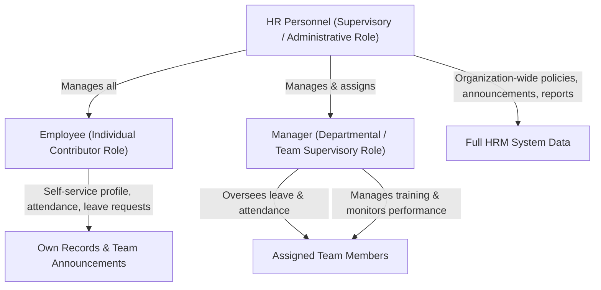

# StaffSync — System Requirements Specification (SRS)

## 1. Document Overview & Context
This document specifies the complete functional and non-functional requirements for **StaffSync**, a modern Human Resource Management System (HRMS) built using the **MERN Stack** (MongoDB, Express.js, React.js, Node.js). 

The requirements in this document are extracted strictly from the project specification documents (`SkillWallet(1).pdf`, `SkillWallet(2).pdf`, `SkillWallet(3).pdf`, and `SkillWallet(4).pdf`). Where industry best practices or implementation necessities require additional clarification, they are explicitly tagged as **[RECOMMENDATION]** to preserve document integrity.

---

## 2. User Roles & Access Control Hierarchy

StaffSync enforces a strict **Role-Based Access Control (RBAC)** architecture with three primary stakeholder roles:

### 2.1 Role Definitions & Permissions Summary

| Role | Scope of Authority | Key Permissions & Responsibilities |
| :--- | :--- | :--- |
| **Employee (`employee`)** | Personal / Self-Service | • Register and log in securely. • View and manage personal profile & contact info. • Mark daily attendance (check-in / check-out). • Apply for leaves and monitor leave request approval status. • View company announcements and news. • Access and participate in assigned training programs. |
| **Manager (`manager`)** | Team / Departmental | • View and manage assigned team members. • Review team members' leave requests (Approve / Reject). • Monitor team attendance records. • Manage and assign team training programs. • Monitor employee performance and progress. • Access Manager Dashboard with team analytics. |
| **HR Personnel (`hr`)** | Organization-wide | • Complete administrative oversight across employees and managers. • Manage employee records (Create, Read, Update, Deactivate/Delete). • Manage managers and department/team mappings. • Track company-wide attendance logs and generate reports. • Final authority on leave requests and organizational policies. • Author and publish organization-wide announcements and news. • View aggregate reports, organizational statistics, and analytics. |

---

## 3. Functional Requirements (FR)

The functional requirements are organized by functional domain and role.

### 3.1 Module 1: Authentication & Security (FR-AUTH)
- **FR-AUTH-01 (Registration):** Employees and users must be able to register with necessary credentials (email, password, role assignment).
- **FR-AUTH-02 (Secure Login):** System must authenticate users via email/username and password using JWT (JSON Web Tokens).
- **FR-AUTH-03 (Password Security):** Passwords must be hashed using `bcryptjs` before persisting to the database. Plaintext passwords must never be stored.
- **FR-AUTH-04 (Role-Based Authorization):** Backend API endpoints and frontend navigation routes must be protected based on user role (`employee`, `manager`, `hr`).
- **FR-AUTH-05 (Session Persistence & Logout):** User session state must be securely maintained on client-side (Redux Toolkit + secure storage) with explicit logout capability clearing tokens.
- **FR-AUTH-06 (Input Validation):** All incoming authentication payloads (email format, password complexity) must be validated at both frontend and backend boundaries.

### 3.2 Module 2: Employee Profile & Personal Information (FR-EMP)
- **FR-EMP-01 (Profile Viewing):** Employees can view their complete personal and professional profile (name, email, role, department, designation, contact information, joining date).
- **FR-EMP-02 (Profile Update):** Employees can update allowable personal information (phone number, address, emergency contact, profile avatar).
- **FR-EMP-03 (HR Employee Management):** HR personnel can view, search, filter, edit, add new employees, and update professional metadata (department, designation, salary band, manager assignment).
- **FR-EMP-04 (Profile Verification):** Sensitive fields (e.g., role, department, manager assignment) cannot be altered by standard employees.

### 3.3 Module 3: Manager & Team Management (FR-MGR)
- **FR-MGR-01 (Team Overview):** Managers can view a dedicated roster of all team members reporting to them.
- **FR-MGR-02 (HR Manager Management):** HR personnel can manage managers, assign departments, and link employees to designated managers.
- **FR-MGR-03 (Team Profile Inspection):** Managers can view profiles, job designations, and contact details of their direct reports.

### 3.4 Module 4: Attendance Management (FR-ATT)
- **FR-ATT-01 (Mark Attendance):** Employees can mark daily attendance (record timestamp for punch-in / check-in and punch-out / check-out).
- **FR-ATT-02 (Attendance History):** Employees can view their historical attendance records (dates, punch times, daily status: Present, Absent, Half-day, Late).
- **FR-ATT-03 (Team Attendance Monitoring):** Managers can view daily and historical attendance records for all their direct team members.
- **FR-ATT-04 (Organization-Wide Attendance Tracking):** HR personnel can track, filter, and audit attendance logs for all departments and employees across the company.
- **FR-ATT-05 (Attendance Status Calculation):** Automatic determination of attendance status (e.g., On-Time, Late, Present, Absent) based on logged timestamps.

### 3.5 Module 5: Leave Management (FR-LEV)
- **FR-LEV-01 (Apply for Leave):** Employees can submit leave requests specifying leave type (Casual, Sick, Annual, Unpaid), start date, end date, and reason.
- **FR-LEV-02 (Leave Status Tracking):** Employees can monitor the real-time status of their submitted leave requests (`Pending`, `Approved`, `Rejected`) along with reviewer remarks.
- **FR-LEV-03 (Manager Leave Review):** Managers can review leave requests submitted by their team members, viewing applicant details, leave type, date range, and reason.
- **FR-LEV-04 (Manager Leave Action):** Managers can approve or reject leave requests with mandatory or optional review feedback comments.
- **FR-LEV-05 (HR Leave Oversight):** HR personnel can view all organizational leave requests, intervene in escalations, handle policy overrides, and approve/reject as required.
- **FR-LEV-06 (Conflict & Validation Checks):** System validates that leave start date is not after end date, and checks against overlapping existing leave periods.

### 3.6 Module 6: Announcements & Internal Communications (FR-ANN)
- **FR-ANN-01 (Create & Publish Announcements):** HR personnel can compose and post company-wide announcements or news (title, message content, priority, publish date).
- **FR-ANN-02 (Announcement Feed):** Employees and Managers can view active announcements in chronological order on their respective dashboards and on a dedicated Announcements page.
- **FR-ANN-03 (Announcement Management):** HR personnel can edit or archive announcements.

### 3.7 Module 7: Training & Development Programs (FR-TRN)
- **FR-TRN-01 (Training Program Management):** Managers (and HR) can create, organize, and manage training and professional development programs (program title, description, instructor/provider, schedule, skill area).
- **FR-TRN-02 (Training Assignment):** Managers can assign team members to specific training programs.
- **FR-TRN-03 (Training Access):** Employees can view and access details of training programs they are enrolled in.
- **FR-TRN-04 (Training Progress & Completion):** Track training completion status (`Enrolled`, `In Progress`, `Completed`) for employees.

### 3.8 Module 8: Employee Performance Monitoring (FR-PRF)
- **FR-PRF-01 (Performance Monitoring):** Managers can review and monitor the performance metrics and progress indicators of their team members.
- **FR-PRF-02 (Performance Records):** Ability to log evaluations, milestone completions, and feedback notes.

### 3.9 Module 9: Notifications & Alerts (FR-NOT)
- **FR-NOT-01 (Event-driven Notifications):** System generates notifications for key workflow events (e.g., leave request submitted, leave approved/rejected, training assigned, new announcement posted).
- **FR-NOT-02 (Notification Inbox):** Users can view their unread notifications and mark notifications as read.

### 3.10 Module 10: Dashboards & Reporting Analytics (FR-DSH)
- **FR-DSH-01 (Employee Dashboard):** Customized dashboard for employees summarizing today's attendance status, recent leave applications, assigned trainings, and latest announcements.
- **FR-DSH-02 (Manager Dashboard):** Supervisory dashboard showing pending team leave approvals, today's team attendance summary, team training progress, and team quick-actions.
- **FR-DSH-03 (HR Dashboard):** Executive/Admin dashboard displaying high-level metrics: total employees, department headcount, daily attendance turnout %, pending leave volume, active trainings, and company announcements.
- **FR-DSH-04 (Reports & Analytics):** HR can access aggregate reports and visual charts on attendance trends, leave utilization, and organizational demographics.

---

## 4. Non-Functional Requirements (NFR)

### 4.1 Security & Compliance (NFR-SEC)
- **NFR-SEC-01 (Token Authentication):** All protected API interactions require an `Authorization: Bearer <JWT>` header with verified signature and expiration check.
- **NFR-SEC-02 (Cryptographic Protection):** Passwords hashed using `bcryptjs` with a minimum salt rounds factor of 10.
- **NFR-SEC-03 (CORS Policy):** Backend configured with `cors` middleware restricting API requests to authorized origins.
- **NFR-SEC-04 (Environment Isolation):** Sensitive configurations (database URIs, JWT secrets, port numbers) managed strictly through `.env` files via `dotenv`.
- **NFR-SEC-05 (Injection & Tampering Protection):** Mongoose schema validation and parameter sanitization to prevent NoSQL injection and parameter pollution.

### 4.2 Performance, Optimization & Scalability (NFR-PERF)
- **NFR-PERF-01 (Database Indexing):** Indexes on high-frequency lookup fields (`email`, `userId`, `employeeId`, `date`, `status`, `managerId`).
- **NFR-PERF-02 (Pagination):** API endpoints for attendance logs, leave histories, employee lists, and announcements must support paginated queries (`page`, `limit`) to avoid payload overload.
- **NFR-PERF-03 (Client-side Lazy Loading):** React routes and large views dynamically imported using `React.lazy()` and `Suspense` for minimal initial bundle size.
- **NFR-PERF-04 (API Response Times):** Standard API responses served in under 200ms under standard local network conditions.

### 4.3 Reliability & Data Integrity (NFR-REL)
- **NFR-REL-01 (Referential Integrity):** Relational links (e.g., `employeeId` in Attendance, Leaves, Trainings referencing `Employees`/`Users`) enforced through Mongoose Schema validation.
- **NFR-REL-02 (Atomic Status Transitions):** Leave status transitions (`Pending` -> `Approved` / `Rejected`) executed deterministically with recorded audit timestamps and approver IDs.
- **NFR-REL-03 (Centralized Error Handling):** Backend Express application with unified error middleware preventing unhandled promise rejections or leaked server stack traces.

### 4.4 User Interface & Responsive Design (NFR-UX)
- **NFR-UX-01 (Multi-Device Responsiveness):** Responsive design functioning smoothly on desktop screens (>= 1366x768), tablets, and mobile viewports using Bootstrap / Material UI grid.
- **NFR-UX-02 (Modern Aesthetic):** Consistent typography, intuitive color-coded status badges (`Approved` = green, `Pending` = yellow/amber, `Rejected` = red), accessible form controls.
- **NFR-UX-03 (State Management):** Predictable global state management using Redux Toolkit slices (`authSlice`, `attendanceSlice`, `leaveSlice`, `announcementSlice`, `trainingSlice`, `notificationSlice`).

### 4.5 Development & Testing Prerequisites (NFR-ENV)
- **NFR-ENV-01 (Operating System):** Cross-platform support for Windows 10/11, macOS, and Linux.
- **NFR-ENV-02 (Runtime & Package Manager):** Node.js runtime (v16.0.0 or higher), npm package manager (v8.0.0 or higher).
- **NFR-ENV-03 (Hardware Baseline):** Intel Core i5 (8th Gen+) or AMD Ryzen 5+, 8 GB RAM minimum (16 GB recommended), at least 1 GB free disk space.
- **NFR-ENV-04 (Testing Coverage):** Rigorous unit and integration test suites covering Authentication, Attendance, Leave Management, Employee Management, and Role Dashboards.

---

## 5. Requirement Traceability Matrix (RTM)

| Requirement ID | Module / Feature | Target Role | Database Collection | Backend API Route | Frontend UI View | Testing Category |
| :--- | :--- | :--- | :--- | :--- | :--- | :--- |
| **FR-AUTH-01/02** | User Register & Login | All | `Users` | `POST /api/auth/register` `POST /api/auth/login` | Login & Register Pages | Authentication Testing |
| **FR-AUTH-04** | Role-Based Access Control | All | `Users` | Middleware: `verifyToken`, `authorizeRoles` | Protected Route Guards | Authentication Testing |
| **FR-EMP-01/02** | Profile Management | Employee | `Employees`, `Users` | `GET /api/employees/me` `PUT /api/employees/me` | Employee Profile Page | Employee Testing |
| **FR-EMP-03** | Manage Employees | HR | `Employees`, `Users` | `GET /api/employees` `POST /api/employees` `PUT /api/employees/:id` | HR Employee Management View | Employee Testing |
| **FR-MGR-01/02** | Manage Managers & Teams | HR, Manager | `Managers`, `Employees` | `GET /api/managers` `GET /api/managers/team` | Manager Team View, HR View | Employee & Dashboard Testing |
| **FR-ATT-01/02** | Mark & View Attendance | Employee | `Attendance` | `POST /api/attendance/mark` `GET /api/attendance/my` | Attendance Page, Employee Dashboard | Attendance Testing |
| **FR-ATT-03** | Team Attendance Monitor | Manager | `Attendance` | `GET /api/attendance/team` | Manager Dashboard, Team Attendance View | Attendance Testing |
| **FR-ATT-04** | Track All Attendance | HR | `Attendance` | `GET /api/attendance/all` | HR Dashboard, Attendance Admin Page | Attendance Testing |
| **FR-LEV-01/02** | Apply & Track Leaves | Employee | `Leaves` | `POST /api/leaves` `GET /api/leaves/my` | Leave Management Page | Leave Testing |
| **FR-LEV-03/04** | Review & Approve Leaves | Manager | `Leaves` | `GET /api/leaves/team` `PUT /api/leaves/:id/status` | Manager Dashboard, Team Leaves View | Leave Testing |
| **FR-LEV-05** | HR Leave Administration | HR | `Leaves` | `GET /api/leaves/all` `PUT /api/leaves/:id/override` | HR Dashboard, All Leaves View | Leave Testing |
| **FR-ANN-01/02** | Announcements System | All (HR post) | `Announcements` | `GET /api/announcements` `POST /api/announcements` | Announcements Page, Dashboards | Dashboard Testing |
| **FR-TRN-01/02** | Manage & Assign Trainings | Manager, HR | `Trainings` | `GET /api/trainings` `POST /api/trainings` `POST /api/trainings/assign` | Training Management Page | Dashboard Testing |
| **FR-TRN-03/04** | Access Training Programs | Employee | `Trainings` | `GET /api/trainings/my` `PUT /api/trainings/:id/progress` | Employee Training View | Dashboard Testing |
| **FR-PRF-01/02** | Performance Monitoring | Manager | `Employees` (or `Trainings`) | `GET /api/managers/performance` | Manager Performance View | Dashboard Testing |
| **FR-NOT-01/02** | Notifications System | All | `Notifications` | `GET /api/notifications` `PUT /api/notifications/:id/read` | Header Notification Bell, Dropdown | Dashboard Testing |
| **FR-DSH-01..03** | Role-Specific Dashboards | All | Aggregates | `GET /api/dashboard/:role` | Employee, Manager, HR Dashboards | Dashboard Testing |
| **FR-DSH-04** | Reports & Analytics | HR | All | `GET /api/reports/analytics` | HR Analytics View | Dashboard Testing |

---

## 6. Documented vs. Recommended Requirements

To ensure zero undocumented scope creep, all proposed system enhancements beyond the raw document text are categorized below:

| Feature / Aspect | Documented in SkillWallet | Recommended Enhancement | Rationale & Value |
| :--- | :--- | :--- | :--- |
| **MERN Architecture** | Yes (MongoDB, Express, React, Node) | None (Strictly adhere to MERN) | Adherence to core prompt requirement. |
| **8 Database Collections** | Yes (`Users`, `Employees`, `Managers`, `Attendance`, `Leaves`, `Announcements`, `Trainings`, `Notifications`) | Strict schema normalization with foreign key references (`ObjectId`) | Ensures referential integrity and performant querying. |
| **Leave Quota Tracking** | Partial (Leaves collection and apply/review workflow) | **[RECOMMENDATION]** Add annual leave balance pool (e.g., 20 days per employee) | Prevents employees from applying for infinite leaves beyond policy. |
| **Attendance Geolocation / IP** | Not specified (only timestamp punch-in/out) | **[RECOMMENDATION]** Optional IP logging / Geofence flag | Useful for enterprise attendance verification. |
| **Performance Reviews Schema** | Documented as Manager feature ("Monitor Employee Performance") | **[RECOMMENDATION]** Include `ratings` & `feedbackNotes` within Employee or dedicated sub-document | Provides concrete data model for performance tracking. |
| **Notification Real-time Delivery** | Documented as `Notifications` collection | **[RECOMMENDATION]** Polling via Axios/Redux interval (or Socket.io in future) | Ensures users receive notification alerts promptly without page reload. |
| **Password Reset Workflow** | Documented as Register/Login & Password Hashing | **[RECOMMENDATION]** Admin password reset by HR | Prevents account lockout if employee forgets credentials. |
